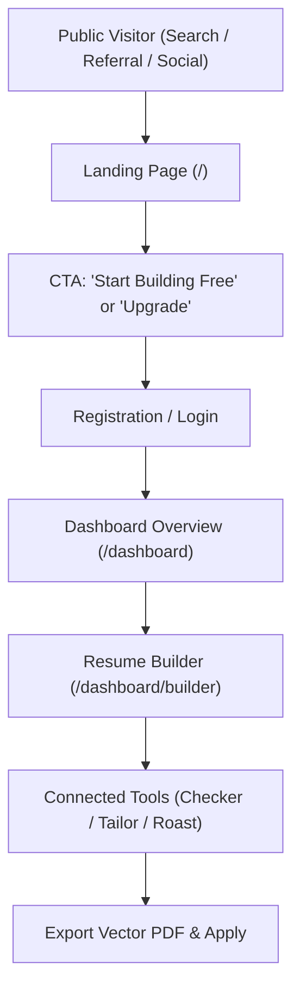

# HICEJO — Comprehensive Pre-Production & Monetization Audit

**Document Date:** September 2026  
**Audience Focus:** US & Western Tech & Professional Job Seekers  
**Strategic Mission:** Deliver an AI Job Search & Application OS so genuinely valuable, rigorous, and polished that job seekers enthusiastically pay for it.

---

## 1. Executive Summary & Production Readiness

Hicejo has reached an impressive level of core functional depth through Phases 1–5:
- **Application Strength Diagnostic**: 8-pillar structural, seniority, and skill evaluation against real Job Descriptions with strictly grounded advice.
- **Resume Roast Room**: Severity-graded diagnostic engine (Critical / Major / Minor), side-by-side Before/After diffs, and privacy-safe shareable roast cards.
- **Resume Builder & Optimizer**: Dynamic utilization gauge, multi-stage single-page auto-fit solver, typography controls, and native searchable vector PDF export.
- **Connected OS Context**: Seamless data and target job description persistence across tools via Zustand and local storage.

### The Critical Gap
While the internal feature engine is exceptional, the product currently operates within an incomplete commercial shell. To win high-paying users in the US, UK, and EU markets who are cautious about their career data, the platform must address critical gaps in mobile responsiveness, landing page proof, security, and onboarding.

---

## 2. Complete User Journey Analysis

### Stage-by-Stage Journey Breakdown

### Stage 1: Discovery & Landing (`/`)
- **Strengths**: High-performance typography (Geist), dark theme aesthetics, responsive grid.
- **Weaknesses**:
  - **Zero Visual Proof**: No screenshots, video walkthroughs, or interactive previews of the builder or 8-pillar scores.
  - **No Social Proof**: Missing user testimonials, ratings, or company logos where candidates landed interviews.
  - **Dead-End CTAs**: Clicking "Upgrade to Pro" ($19/mo) merely routes to `/register` without preselecting a plan or opening a checkout flow.
  - **Empty Footer**: Lacks links to Privacy Policy, Terms of Service, Blog, Templates, or Support.

### Stage 2: Authentication (`/login`, `/register`)
- **Strengths**: Google OAuth and Email/Password work seamlessly with offline fallback.
- **Weaknesses**:
  - **No Password Recovery**: Missing "Forgot Password?" flow.
  - **Compliance Risk**: Missing Terms of Service and Privacy Policy consent checkbox (a requirement under US CCPA and GDPR).
  - **Demo Mode Leak**: The "Explore in Demo Mode" button is prominently visible in production UI, reducing perceived professionalism.

### Stage 3: Onboarding & First-Run
- **Current Experience**: After registration, users are redirected to an empty dashboard with no guided questions.
- **Friction Point**: If a new user navigates directly to the builder, they encounter a blank canvas. Although high-quality starter templates exist, the modal does not auto-prompt for first-time users.

### Stage 4: The Application OS (Core Engine)
- **Status**: **Strongest part of Hicejo**.
- **Experience**: The workflow between Checker ↔ Tailor ↔ Roast ↔ Builder ↔ Cover Letter is cohesive. Recommendations bridge cleanly into the editor, and undo/redo stacks safeguard the candidate's draft.

---

## 3. UI/UX & Design Quality Audit

| Component / Screen | UX Grade | Key Observations |
|---|:---:|---|
| **Resume Builder** | **A** | Dynamic page utilization gauge, multi-stage "Fix to 1 Page" solver, real-time font/margin adjustments, instant printable vector PDF. |
| **Application Strength** | **A** | Clean 8-pillar radial meters, uplift roadmap, actionable recommendations with strict anti-fabrication guidance. |
| **Roast Room** | **A-** | Hilarious yet rigorous critiques, severity tagging (Critical/Major/Minor), side-by-side Before/After diffs, client-side shareable card. |
| **Dashboard Overview** | **B+** | Recharts ATS trajectory curve, quick actions, metric cards. Needs deeper history tracking per document rather than across files. |
| **Mobile Experience** | **F (Critical)** | The desktop sidebar (`Sidebar.tsx`) lacks mobile responsive breakpoints (`hidden md:flex` is missing). On mobile screens, the sidebar remains at 260px, squishing dashboard content into an unreadable 115px column. |
| **Landing Page** | **C+** | Polished code, but text-heavy and devoid of product media. No comparison table against Teal/Jobscan. |

---

## 4. AI Output Quality & Integrity

### Prompt Engineering Strengths
- The prompts in `check/route.ts` and `roast/route.ts` maintain high standards of integrity, forbidding invented metrics or experiences and requiring grounded observations.

### Critical Prompt Vulnerability (`enhance-bullet/route.ts`)
- Rule #2 in `enhance-bullet` explicitly states:
  > *"Incorporate realistic metrics (e.g., improved speeds by 30%, increased engagement by 15%, reduced bugs by 20%)"*
- **Issue**: This actively instructs the model to hallucinate false metrics. It must be revised to focus on quantifiable impact only when indicated by the user's notes, without fabricating specific numbers.

### Technical Model Configuration (`src/lib/ai.ts`)
- `src/lib/ai.ts` references `gemini-3.5-flash-lite`, which is not an active endpoint in Google Generative AI APIs.
- When `GEMINI_API_KEY` is provided, requests fail with a 404 error. This must be updated to official models (`gemini-2.0-flash` or `gemini-1.5-flash`).
- API calls lack a timeout parameter, risking hung serverless functions on upstream latency.

---

## 5. Competitive Differentiation & Value Proposition

Why a US/Western job seeker would choose and pay for Hicejo over Teal, Jobscan, or Rezi:

| Feature Area | Competitor Standard (Jobscan / Teal) | Hicejo Current State | Competitive Advantage |
|---|---|---|---|
| **ATS Diagnostics** | Primitive keyword density matching | **8-Pillar Application Strength** (Scope, Seniority, Impact, Credentials) | High credibility for senior, engineering, and managerial roles. |
| **Resume Sizing** | Manual spacing adjustments | **Multi-stage auto-fit solver** with one-click page budgeting | Substantial time savings over manual Google Docs/Word formatting. |
| **Workflow State** | Disconnected tools or rigid lists | **Connected OS Context** (Target JD and recommendations follow the user) | Eliminates repetitive copy-pasting across tools. |
| **Engagement** | Plain text audits | **Resume Roast Room** with severity-graded issues and shareable cards | Strong organic acquisition and viral loop. |

---

## 6. Infrastructure, Security & Monetization Gaps

1. **Client-Side Credit Vulnerability (`credits.ts`)**:
   - Daily credit limits are stored exclusively in browser `localStorage`. Any user can bypass limits by clearing their browser storage. Backend routes do not check or decrement credits.
2. **Unauthenticated Public API Access**:
   - If raw `resumeText` is submitted without a `resumeId`, 6 out of 7 AI endpoints process the request without checking for authentication or applying rate limits, exposing API keys to abuse.
3. **Broken Template Catalog (`/templates`)**:
   - Visiting `/templates` returns a **404 Not Found**. The navigation menu hardcodes the link to a single software engineer template. Clicking "Use This Template" does not hydrate the builder with starter data.
4. **Missing Payment Infrastructure**:
   - The landing page advertises a $19/mo Pro plan, but there is no Stripe checkout session, webhook handler, or billing management portal in Settings.

---

## 7. Actionable Pre-Production Roadmap

### Phase P0: Critical Blockers (Mobile & Security)
- [ ] **Mobile Dashboard Shell**: Hide the fixed sidebar on mobile viewports (`hidden md:flex`) and implement an off-canvas mobile drawer with a top bar hamburger toggle.
- [ ] **Secure AI Routes**: Require authenticated sessions across all generative endpoints; implement server-side rate limits and input character limits.
- [ ] **Model Configuration Fix**: Update `src/lib/ai.ts` to use valid model identifiers (`gemini-2.0-flash` / `gemini-1.5-pro`) and add a 15-second client timeout.
- [ ] **Eliminate Hallucination in `enhance-bullet`**: Reframe the prompt to strengthen existing achievements without fabricating arbitrary numbers.
- [ ] **Template Catalog & Hand-off**: Create `/templates/page.tsx` and pass `?template=[slug]` to hydrate the builder with template content on load.

### Phase P1: Trust & Western Market Credibility
- [ ] **Landing Page Visual Evidence**: Add high-resolution UI screenshots or an interactive preview of the Builder, ATS Checker, and Roast Card.
- [ ] **Social Proof & Testimonials**: Add realistic candidate placement stories, metrics (e.g., "Over 15,000 resumes scanned"), and company target logos.
- [ ] **Auth & Legal Compliance**: Implement a "Forgot Password?" flow, along with dedicated Terms of Service and Privacy Policy pages linked in the footer and registration form.
- [ ] **First-Time User Onboarding**: Add a simple welcome dialog post-registration prompting users to either upload an existing resume or select a curated template.

### Phase P2: Commercialization & Growth
- [ ] **Stripe Checkout & Billing Portal**: Implement Stripe Checkout for the $19/mo Pro plan and add subscription management to the Settings page.
- [ ] **Database Credit Tracking**: Move credit balances from `localStorage` to Supabase to safeguard API margins.
- [ ] **Public SEO Landing Pages**: Add `/tools/ai-resume-builder` and a dedicated `/pricing` page with structured data.
